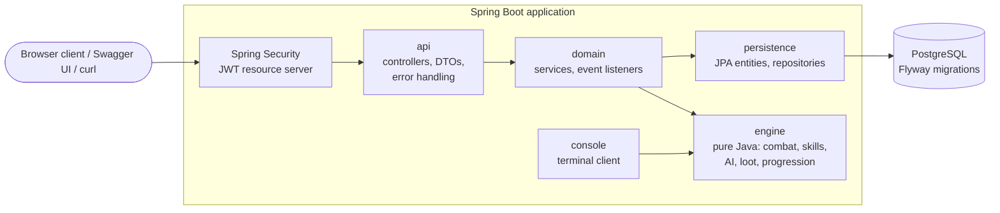
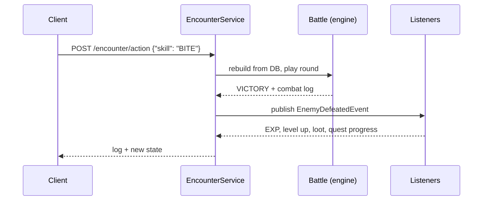

# Cheems Quest

[](https://github.com/Varant5/Cheems-Quest/actions/workflows/ci.yml)


A turn-based text RPG played entirely over a REST API. You are Cheems, a small dog with a big stick.
Explore the world, bonk Karens, level up, collect loot and finish quests. Much bonk. Very API.

```text
POST /api/characters/{id}/encounter/action  {"skill": "BONK"}

"Cheems uses Bonk!",
"Neighbor's Lil Doge loses 5 HP.",
"Neighbor's Lil Doge is down!",
"VICTORY! Cheems earns much respect.",
"Cheems gains 8 EXP.",
"Loot! Neighbor's Lil Doge drops Very Stick (COMMON)."
```

## Features

- **Turn-based combat** with three skills, critical hits, misses, multi-enemy fights and status effects (poison, stun).
- **Tactical enemy AI**: weighted skill tables per enemy, adjusted to the fight. Enemies do not re-poison a poisoned Cheems and go for a finishing bite when HP runs low.
- **World map** of eight locations in two regions, with random encounters, exits gated by level, quest or item, fog of war over unexplored places, and a safe home where Cheems naps to full HP.
- **Progression**: experience, levels and stat growth.
- **Items and equipment** in four slots, with rarities from COMMON to LEGENDARY.
- **Weighted loot tables** with a drop chance per enemy, plus gold drops.
- **Gold economy**: sell loot, buy Cheemsburgers, Lucky Dice and Doge Coins in the doghouse shop.
- **Quests** to defeat enemies, visit places or find items, with EXP or item rewards and follow-up quests that unlock in a chain.
- **Accounts** with JWT authentication. Players can only touch their own characters.
- **Browser client**: a single static page in plain HTML, CSS and JavaScript, served by Spring Boot itself.
- **OpenAPI docs** with Swagger UI.

## Quick start

Requirements: Docker.

```bash
docker compose up --build
```

Open <http://localhost:8080>, register and play in the browser. Move by clicking the map, with the compass or `WASD` / arrow keys,
fight with `1` `2` `3`, use a Cheemsburger or Lucky Dice mid-fight with `4`+, click an enemy to target it.
Buy consumables in the doghouse shop.

Prefer raw HTTP? Swagger UI lives at <http://localhost:8080/swagger-ui.html>: register, click **Authorize**,
paste the token and call the endpoints directly.

Port 8080 taken? Run `APP_PORT=8081 docker compose up --build` instead.

## Example session

```bash
# 1. Register and keep the token
curl -s -X POST localhost:8080/api/auth/register \
  -H 'Content-Type: application/json' \
  -d '{"username": "bonk_master", "password": "much-secret-very-safe"}'
# {"accessToken":"eyJraWQiOi...","tokenType":"Bearer","expiresIn":3600,"username":"bonk_master"}

TOKEN=eyJraWQiOi...

# 2. Create a character
curl -s -X POST localhost:8080/api/characters \
  -H "Authorization: Bearer $TOKEN" -H 'Content-Type: application/json' \
  -d '{"name": "Cheems"}'
# {"id":"6b2f1290-...","name":"Cheems","level":1,"hp":65,"maxHp":65,"attack":16,"defense":3,
#  "location":{"code":"CHEEMS_DOGHOUSE","exits":["NORTH","EAST"], ...}}

# 3. Walk into danger
curl -s -X POST localhost:8080/api/characters/$ID/move \
  -H "Authorization: Bearer $TOKEN" -H 'Content-Type: application/json' \
  -d '{"direction": "EAST"}'
# {"message":"You enter Karen's Basement. Neighbor's Lil Doge blocks the path!",
#  "encounter":{"status":"PLAYER_TURN","enemies":[{"position":0,"name":"Neighbor's Lil Doge","hp":20,"maxHp":20}]}, ...}

# 4. Fight
curl -s -X POST localhost:8080/api/characters/$ID/encounter/action \
  -H "Authorization: Bearer $TOKEN" -H 'Content-Type: application/json' \
  -d '{"skill": "BONK"}'
# {"log":["Cheems uses Bonk!","Neighbor's Lil Doge loses 15 HP.",
#         "Neighbor's Lil Doge uses Bite!","Cheems loses 6 HP."],
#  "status":"PLAYER_TURN","hp":59, ...}
```

## API

| Method | Endpoint | Description |
|---|---|---|
| POST | `/api/auth/register` | Create an account, returns a JWT |
| POST | `/api/auth/login` | Exchange credentials for a JWT |
| GET | `/api/characters` | List my characters |
| POST | `/api/characters` | Create a character |
| GET | `/api/characters/{id}` | Stats and current location |
| GET | `/api/characters/{id}/map` | Explored locations on a grid, unexplored neighbours shown as ??? |
| POST | `/api/characters/{id}/move` | Move `NORTH`, `SOUTH`, `EAST` or `WEST`, may start a fight |
| GET | `/api/characters/{id}/encounter` | Current fight |
| POST | `/api/characters/{id}/encounter/action` | Use `BONK`, `BITE` or `BONKING_SPIN` (optionally on a `target`), or a consumable `item` |
| GET | `/api/characters/{id}/inventory` | Items and stats with equipment |
| POST | `/api/characters/{id}/inventory/{itemId}/equip` | Equip an item |
| POST | `/api/characters/{id}/inventory/{itemId}/unequip` | Unequip an item |
| POST | `/api/characters/{id}/inventory/{itemId}/use` | Use a consumable (Cheemsburger, Doge Coin) |
| POST | `/api/characters/{id}/inventory/sell` | Sell unequipped copies of an item for gold |
| GET | `/api/characters/{id}/shop` | Offers of the shop in the current location |
| POST | `/api/characters/{id}/shop/buy` | Buy items for gold |
| GET | `/api/characters/{id}/quests` | Quest log |
| POST | `/api/characters/{id}/quests/{code}/accept` | Accept a quest |

Errors use [RFC 9457 Problem Details](https://www.rfc-editor.org/rfc/rfc9457):
`400` validation, `401` missing or invalid token, `403` someone else's character,
`404` unknown resource, `409` game rule violations such as walking into a wall or leaving a fight.

## Architecture



The layers are enforced by [ArchUnit tests](src/test/java/com/cheemsquest/ArchitectureTest.java):
`engine` depends on nothing but the JDK, `persistence` is reachable only from `domain`, and nothing depends on `api`.

### Design highlights

- **Framework-free engine.** Combat, skills, AI, loot and leveling are plain Java, unit-tested with an injected
  `RandomGenerator` so every roll is deterministic in tests. The same engine powers a
  [terminal client](src/main/java/com/cheemsquest/console/ConsoleGame.java).
- **Strategy pattern for skills.** `Bonk`, `Bite` and `BonkingSpin` implement one `Skill` interface:
  reliable hit with crits, strong but unreliable bite, weaker hit on every enemy.
- **State pattern for battles.** A sealed `BattleState` hierarchy (`PlayerTurn`, `EnemyTurn`, `Victory`, `Defeat`)
  rejects illegal moves such as acting after the fight is over.
- **Stateless encounters.** The battle is rebuilt from the database on every request and saved with optimistic
  locking, so two parallel actions cannot both hit the same enemy.
- **Spring events for rewards and quests.** Winning a fight publishes one `EnemyDefeatedEvent`. Separate ordered listeners
  grant EXP, roll loot and count quest kills, so adding a new reward type does not touch combat code.
  Moving and receiving items publish `LocationEnteredEvent` and `ItemAcquiredEvent`, and one quest listener
  turns all three into progress for typed objectives.
- **Reusable weighted tables.** One `WeightedTable` drives enemy AI, encounter spawns and loot drops.
- **Data-driven world.** Locations, exits, enemies, items, loot and quests are seeded by Flyway migrations.
  The map has no stored coordinates: `WorldLayout` walks the exits from home and places every location on a grid,
  rejecting worlds whose exits overlap or do not fit.
- **Ownership checks.** `@PreAuthorize` on every character endpoint asks the domain whether the character belongs
  to the player from the token.



## The world

```text
    Bonk Peak                                     Buff Doge Tower
        |                                                |
    [lvl 5]                                          [lvl 3]
        |                                                |
   Echo Cave --[Headlamp Hat]-- Bonk Pass --[Leg Day]-- Much Swamp ---- Wow Forest
                                                                             |
                                                                   Cheems' Doghouse ---- Karen's Basement
```

Gated exits only open when Cheems reaches a level, finishes a quest or carries an item.
The way back is always open.

| Enemy | HP | Found in | Drops |
|---|---|---|---|
| Neighbor's Lil Doge | 20 | Wow Forest, Karen's Basement, Much Swamp | Very Stick, Spiky Collar |
| Wild Karen Doge | 35 | Karen's Basement, Wow Forest | Karen's Wig, Spiky Collar |
| Soggy Shibe | 28 | Much Swamp, Bonk Pass | Soggy Raincoat, Spiky Collar |
| Buff Doge | 120 | Buff Doge Tower | Buff Harness, Stonks Helmet, Legendary Bone |
| Mountain Goat Doge | 55 | Bonk Pass, Echo Cave | Headlamp Hat, Spiky Collar |
| Cave Bat Shibe | 42 | Echo Cave | Bat Fang Necklace, Headlamp Hat |
| Abominable Snow Doge | 150 | Bonk Peak | Yeti Fur Coat, Frost Bone |

| Quest | Objective | Requires | Reward |
|---|---|---|---|
| Karen Problems | Defeat 3 Wild Karen Doges | - | 60 EXP, Stonks Helmet |
| Never Skip Leg Day | Defeat Buff Doge | Karen Problems | 150 EXP, Doge Coin |
| Much Mystery Smell | Visit Much Swamp | - | 25 EXP, Cheemsburger |
| Manager Material | Find 2 Karen's Wigs | - | 80 EXP, Spiky Collar |

## Tech stack

Java 25, Spring Boot 4.1 (Web MVC, Data JPA, Validation, Security with OAuth2 Resource Server),
PostgreSQL 17, Flyway, springdoc-openapi, Lombok,
JUnit 5, AssertJ, MockMvc, Testcontainers, ArchUnit, Docker, GitHub Actions.

## Development

Requirements: JDK 25 and Docker, which runs PostgreSQL for the app and Testcontainers for the tests.

```bash
./mvnw spring-boot:run   # starts only the database container, then the app on :8080
./mvnw verify            # unit, architecture and integration tests + coverage check
```

`verify` writes a JaCoCo report to `target/site/jacoco/index.html` and fails the build when line coverage
drops below 90% overall or below 95% lines / 85% branches in any `engine` package.
CI shows the totals in the run summary and attaches the HTML report.

The terminal client needs no database:

```bash
./mvnw compile
java -cp target/classes com.cheemsquest.console.ConsoleGame
```

### Configuration

| Variable | Default | Description |
|---|---|---|
| `JWT_SECRET` | development key | Base64 HMAC key, at least 32 bytes. **Set your own outside local play.** |
| `JWT_TTL` | `1h` | Token lifetime |
| `DB_HOST`, `DB_PORT`, `DB_NAME`, `DB_USER`, `DB_PASSWORD` | `localhost`, `5432`, `cheemsquest`, `cheems`, `cheems` | Database connection |
| `APP_PORT` | `8080` | Host port used by `docker compose` |

Generate a secret with `openssl rand -base64 48`.

## Project structure

```text
src/main/java/com/cheemsquest
├── api          REST controllers, request DTOs, security and OpenAPI config
├── domain       services, Spring event listeners, views
├── persistence  JPA entities and repositories
├── engine       pure Java game logic (combat, skill, loot, progression, ...)
└── console      terminal client built on the engine
src/main/resources/db/migration   Flyway schema and world data
src/main/resources/static         browser client (index.html, assets/app.js, assets/app.css)
```
